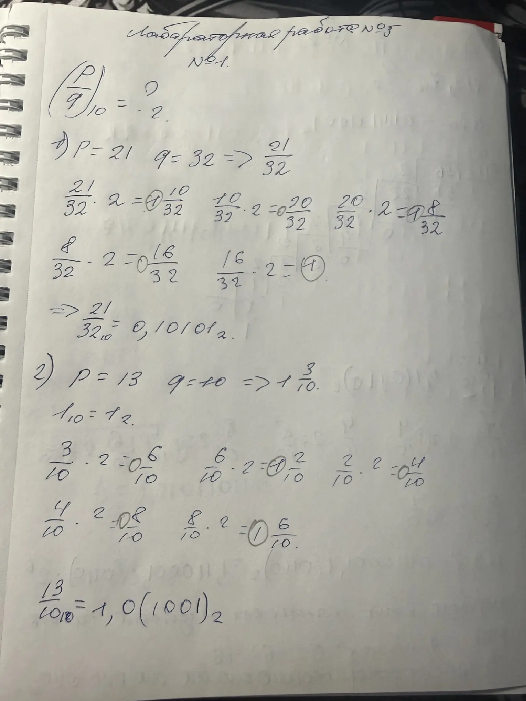
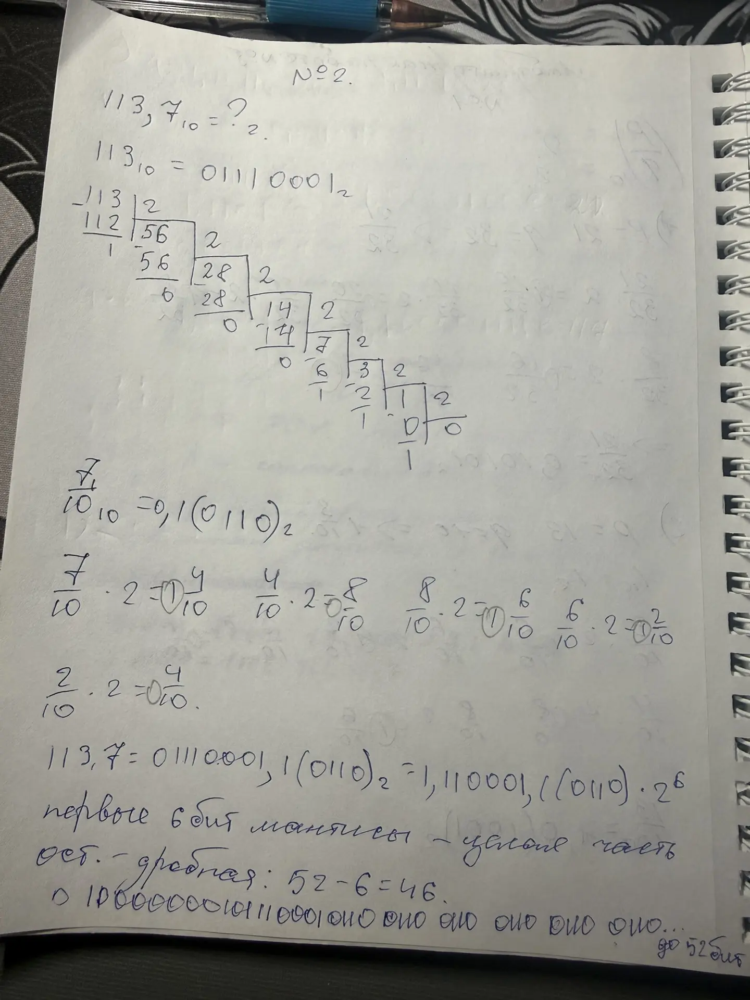
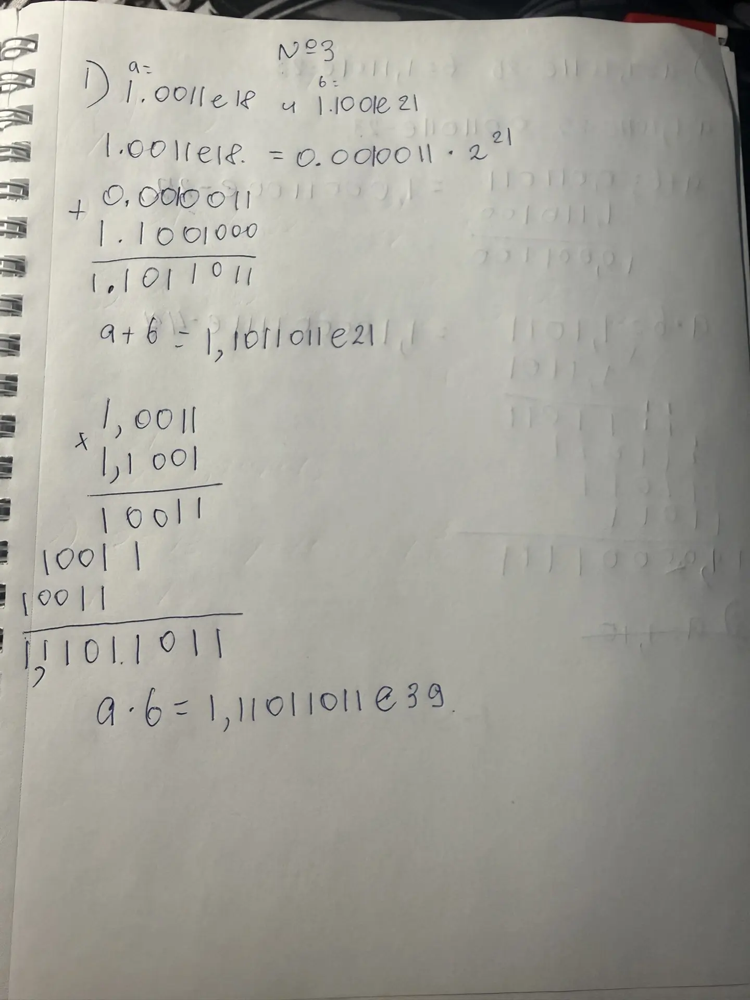
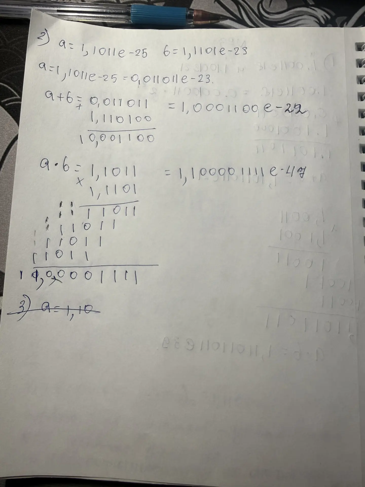
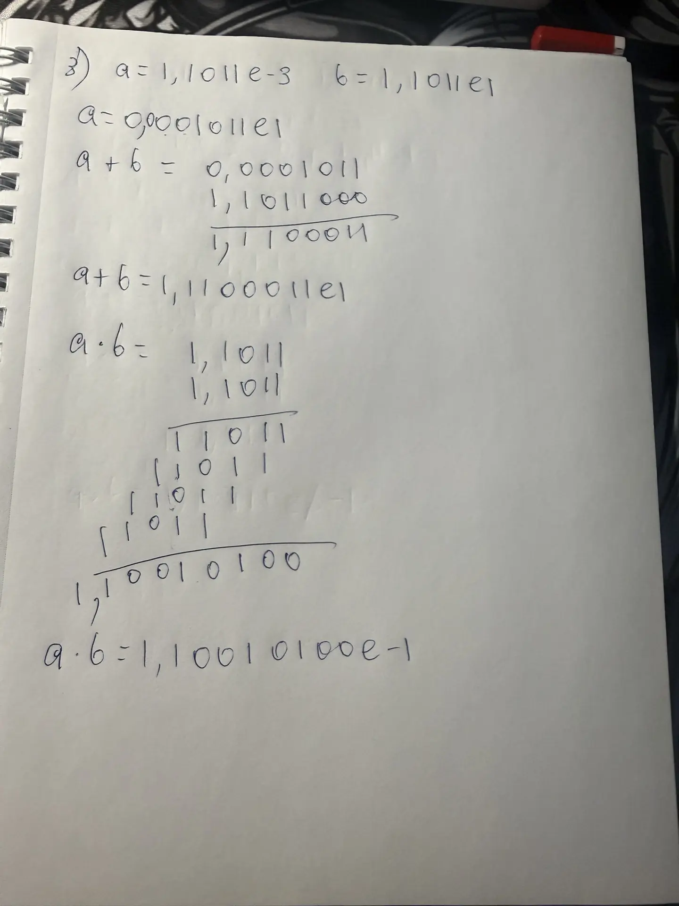

# Языки программирования
## Лабораторная работа 5

### Задание 1 **(2)**
*Переведите в двоичную запись два произвольных рациональных числа (числа вида* $\frac{p}{q}$).
*У одного из чисел знаменатель должен быть степенью двойки (32), а у другого --- некоторым числом
от 9 до 12.*

*Запись второго числа будет содержать период. Его надо найти. При решении задачи нельзя 
использовать вычислительную технику. Процесс решения должен быть представлен в отчете.*



### Задание 2 **(3)**
*Переведите в двоичную запись и найдите машинное представление в типе* **double**
*для произвольного вещественного числа большего, чем 100 с одним знаком после точки, например
для* $113.7$. *Цифра после точки не должна быть нулем иля пятеркой.*

*При решении задачи нельзя 
использовать вычислительную технику. Процесс решения должен быть представлен в отчете.*




### Задание 3 **(3)**
*Найдите сумму и произведение для записанных далее пар чисел. Числа заданы в двоичной записи 
в экспоненциальном виде. Ответ необходимо записать в нормализованннои экспоненциальном виде.*

* 1.0011e18 и $1.1001e21;
* 1.1011e-25 и, $1.1101e-23;
* 1.1011e-3 и $1.1011e1.
  
*При решении задачи нельзя 
использовать вычислительную технику. Процесс решения должен быть представлен в отчете.*





### Задание 4 **(2)**

*Рассмотрим следующий пример в IDLE Python*
```
>>> x = 99.99
>>> int(x/10+0.001)
9
```
*Результат должен был быть равен 10, однако оказался другим. Почему так произошло?
Как исправить программу, чтобы она корректно переводила вещественные числа в целые?*

при `x/10` появляется погрешность, при `+0.001` также есть погрешность и в итоге получается число очень приближенное к 10 но не равное 10
99.99 в двоичной системе точно не записывается. Это бесконечная дробь с периодом, и в double её обрезают до 52 бит отсюда и появляется погрешность.
А `int` окугляет вещественное по целой части(отбрасывает дробную часть).

исправить программу можно использованием округлением до ближайшего целого(round() ).

### Задание 5. **(2)**

*Рассмотрите следующую программу. Объясните результаты ее работы. В частности,
как величина* $y$ *повлияла на ответ?*
```
x = 1/3
y = 1
for i in range(20):
    print((x+y)-y)
    y*=10
```
*В отчете требуется привести вычисления для оценки погрешности.*


В программе переменная `x` равна `1/3`, то есть примерно `0,3333333333333333`. Переменная `y` сначала равна `1`, а после каждой итерации цикла увеличивается в 10 раз. Всего цикл выполняется 20 раз.
выражение `(x+y)-y` должно быть равно `x`, но из-за ограниченной точности хранения вещественных чисел результат отличается. Погрешность вычисляется по формуле: |(x+y)-y-x| (модуль разности между полученным результатом и исходным значением)


при `y=1` результат равен примерно 0,33333333333333326, а погрешность составляет около 5,55 умн на 10^-17.
При `y=10^10` результат равен примерно 0,33333396911621094, а погрешность составляет около 6,36 умн на 10^-7.
При `y=10^15` результат равен 0,375, а погрешность составляет примерно 0,0416667. При `y=10^16` результат становится равным 0, а погрешность составляет примерно 0,3333333.
Таким образом, при увеличении значения y погрешность возрастает. Это происходит потому, что при сложении большого числа `y` с маленьким числом `x` дробная часть x постепенно теряется из-за ограниченной точности типа float.


### Задание 6 **(2)**

*Для какого минимального значения* $n$ *программа на С++ выведет* **inf**? *Объясните
ответ.* *Что произойдет, если тип* **double** *заменить на* **long double**?
```
int n=...;
double s = pow(2, n);
std::cout << std::fixed << s << std::endl;
```

Для типа double минимальное значение n равно 1024. Это связано с тем, что при вычислении 2^{1024} результат превышает максимально возможное значение данного типа, поэтому программа выводит inf. При n=1023 переполнения ещё не происходит.
Если вместо double использовать long double, если этот тип имеет расширенный диапазон, переполнение произойдёт при n=16384.

### Задание 7 **(2)**

*Допишите что-либо вместо многоточия программе на С++, чтобы программа при запуске выдавала ответ* **yes**.
```
double s = 0.0/0.0;
if (s != s)
  std::cout << "yes";
```

### Задание 8 **(2)**

*Какое минимальное натуральное число при преобразовании в тип* **double** *записывается с погрешностью? Объясните
ответ. Почему следующее за ним число уже выводится без погрешности?*

минимальным натуральным будет 2^53 + 1 так как мантиса вмещает в себя 53 разряда(52+неявная 1) любое число до 2^53 вмещается в мантису а свыше 
уже вычисляется с погрешностью

Следующее за ним число 2^53 + 2 чётное и в этом промежутке представимо точно: оно равно 1,00…01 · 2^53, где единица стоит в последнем (52-м) бите мантиссы. Никакого округления не требуется, поэтому оно выводится без погрешности.

###  Задание 9 **(2)**
*Напишите программу для решения следующей задачи.*

*Даны четыре рациональных числа. (Рациональное число - это число вида*
$\frac{p}{q}$, *где* $p$ *и* $q$ - *целые числа.) Напишите программу, которая сравнит сумму
двух первых чисел с суммой двух последних чисел. Программа должна выводить* $1$, $0$ *или* $-1$
*в зависимости от результатов сравнения. Решение можно проверить в проверяющей системе*
[http://olymp3.isu.ru/cgi-bin/new-client?contest_id=102](http://olymp3.isu.ru/cgi-bin/new-client?contest_id=102), *задача 03*.
## Дополнительные задания

### Задание 1 **(3)**

*Чем отличаются машинные представления чисел* $1$, $4096$, $0.0625$, *в типе* **double**? *Почему?*

### Задание 2 **(4)**
*Напишите программу для решения следующей задачи.*

*Даны четыре вещественных числа
a,b,c,d, не превосходящие 100 по модулю, записанные не более чем с 10 знаками после точки.
Требуется сравнить суммы a+b и c+d и определить, какая из них больше. Возможен случай,
что суммы будут равны.* 

*От вас требуется обосновать выбор значения* **eps** *при сравнении.*

### Задание 3 **(5)**
*Задано вещественное число в десятичной записи. Напишите программу для нахождения первых 1000 разрядов
этого числа в двоичной записи.*


### Задание 4 **(3)**
*Изучая чужой код, программист обнаружил такую функцию.*
```
long double acos_e(long double x, long double ep){
  if (x > 1+ep || x < -1-ep)
    return 0.0 / 0.0;
  else if (x>1)
    x=1;
  else if (x<-1)
    x=-1;
  return acos(x);
}
```
*Чем отличается эта функция от обычной функции арккосинуса? В чем смысл дополнительных проверок?*
### Задание 5 **(5)**
*Заданы координаты точек* $A$, $B$, $C$ *на плоскости. Координаты являются вещественными числами в диапазоне* $[0;10)$
*и содержат не более 6 знаков после точки. Используя формулу векторного произведения, напишите программу
для определения расположения* $C$ *относительно вектора* $AB$ *(слева, справа, на прямой).*

*От вас требуется обосновать выбор значения* **eps** при сравнении.*
