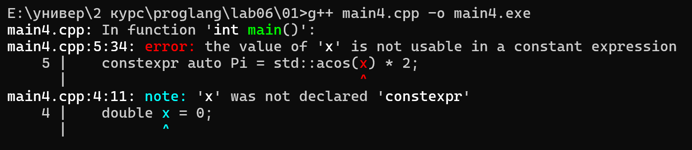
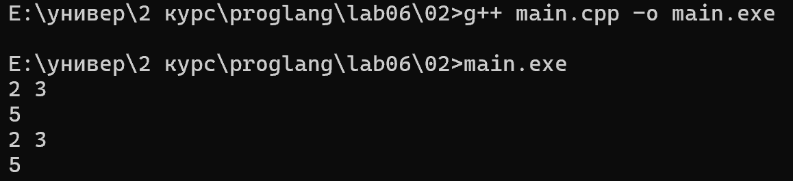
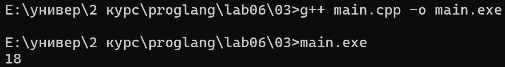
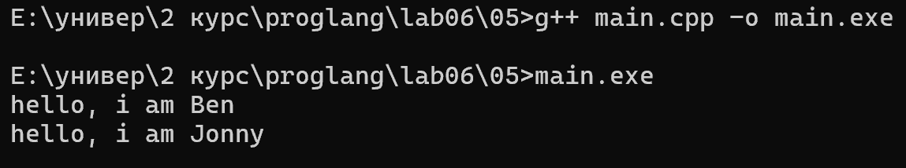
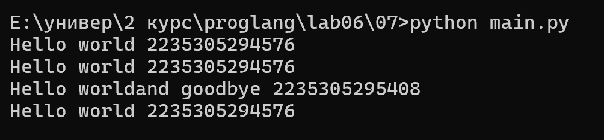
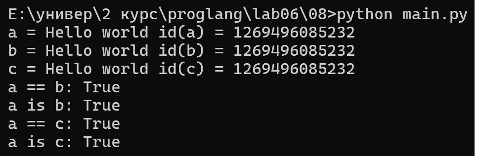
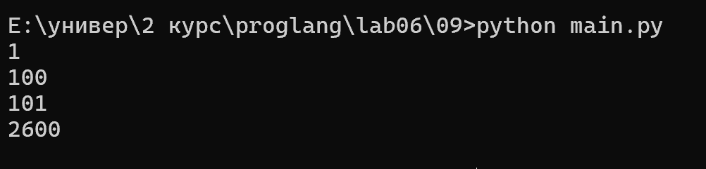

# Языки программирования
## Лабораторная работа 6

### Задание 1 **(3)**
*Рассмотрим следующую программу на С++.*
```
#include <iostream>
#include <cmath>
int main() {
   double x = 0;
   const auto Pi = std::acos(0) * 2;
   std::cout << Pi << std::endl;
   return 0;
}
```
*Проверьте четыре способа объявления* **Pi**.
* ```const auto Pi = acos(0) * 2;```
* ```constexpr auto Pi = std::acos(0) * 2;```
* ```const auto Pi = acos(x) * 2;```
* ```constexpr auto Pi = std::acos(x) * 2;```

*Что можно сказать об этих вариантах? Проверьте, в каких вариантах объявляется константа этапа трасляции.*

*Тексты программ разместите в папке с номером задания*

* ```const auto Pi = acos(0) * 2;``` Компилируется без проблем (const просто делает переменную неизменяемой.
* ```constexpr auto Pi = std::acos(0) * 2;``` Компилируется без проблем (константа этапа трансляции)(constexpr заставляет компилятор посчитать значение прямо во время сборки кода)
* ```const auto Pi = acos(x) * 2;```  Компилируется без проблем
* ```constexpr auto Pi = std::acos(x) * 2;```   Не компилируется, вылетает ошибка: 


### Задание 2 **(2)**
*Проверьте работу следующей программы на С++*
```
#include <iostream>
int main() {
   {
      int x, y;
      std::cin >> x >> y;
      std::cout << x+y << std::endl;
   }
   {
      double x, y;
      std::cin >> x >> y;
      std::cout << x+y << std::endl;
   }
   return 0;
}
```
*Нужны ли в этой программе вложенные фигурные скобки? Дайте подробный ответ с объяснением причин.*

выполнив программу получим:


убрав скобки получим:
![скрин cmd)(2_2.png)
программа не компилируется тк в одной области видимости main две пары переменных с одинаковыми именами (в первом случае скобки разбивали на две области видимости)
поэтому скобки нужны

### Задание 3 **(2)**
*Проверьте работу следующего фрагмента программы на С++.*
```
int s = 0;
for (int i = 0; i < 4; i++) {
   for (int i = 0; i < 3; i++) {
      s += i;
   } 
   s += i; 
}
std::cout << s;
```
*В результате каких вычислений был получен ответ? Дайте подробный ответ.*

выполнив программу получим:


в программе два вложенных цикла и в обоих используется переменная ```i``` 

выполняется 4 шага внешнего цикла. причем на каждом шаге внешнего цикла к ```s``` прибавляется 3(тк внутренний цикл делает всегда три шага и за один полный проход внутренного цикла к ```s``` прибавляется 0+1+2) и значение i внешнего цикла
т.е 
шаг 1: s+0+3   //3
шаг 2: s+1+3   //7
шаг 3: s+2+3   //12
шаг 4: s+3+3   //18


### Задание 4 **(2)**

*Проверьте работу следующего фрагмента программы на* **Python**.
```
s = 0
for i in range(4):
   for i in range(3):
      s += i
   s += i
print(s)
```
*В результате каких вычислений был получен ответ? Дайте подробный ответ.*

*На основе этих примеров поясните различия между* **С++** и **Python** *при работе с переменными*.

По шагам внешнего цикла:

Шаг 1: i = 0 => внутр. цикл (s += 0, s += 1, s += 2) => внеш. цикл (s += 2) => s = 5, i = 2.

Шаг 2: i = 1 => внутр. цикл (s += 0, s += 1, s += 2) => внеш. цикл (s += 2) => s = 10, i = 2.

Шаг 3: i = 2 => внутр. цикл (s += 0, s += 1, s += 2) => внеш. цикл (s += 2) => s = 15, i = 2.

Шаг 4: i = 3 => внутр. цикл (s += 0, s += 1, s += 2) => внеш. цикл (s += 2) => s = 20, i = 2.

Результат: 20.

при использовании одинаковых имён переменных во вложенных циклах Python внутренний цикл влияет на значение переменной внешнего цикла


### Задание 5 **(2)**

*Напишите свой пример программы на* **С++**, *создающий и использующий пространства имен. Программа
должна содержать не менее двух пространств имен.*

программа в папке 05

выполнив программу получим:



### Задание 6 **(2)**

*Рассмотрим следующий фрагмент программы. Эта программа 1000000 раз обменивает значения двух длинных 
строк с использованием третьей строки. Проверьте, насколько быстро она работает.*

```
std::string a(100000, 'a');
std::string b(100000, 'b');
for (int i=0;i<1000000;i++) {
   std::string c(a);
   a = b;
   b = c;
}
std::cout << a[0] << b[0];
```
*Попробуйте использовать для обмена значений строк функцию* **swap**. 
*Проверьте, изменилось ли время работы. В чем ошибка исходной программы?
Исправьте исходную программу, чтобы ускорить ее работу. Изменения не должны 
затрагивать общий вид программы (присваивания, использование временной переменной).*

изменил тело цикла на:
```
    std::string c;
    c.swap(a);
    a.swap(b);
    b.swap(c);
```
изначально ```std::string c(a)``` создаёт копию строки Присваивания a = b и b = c могут копировать содержимое длинных строк.При миллионе повторений эти операции создают значительную дополнительную работу.
swap() обменивает внутренние ресурсы строк, что для string быстрее, чем копирование всех символов.

### Задание 7 **(2)**

*Рассмотрим программу на языке* **Python**.
```
a = 'Hello world'
print(a, id(a))
b = a
print(b, id(b))
a += ' and goodbye'
print(a, id(a))
print(b, id(b))
```
*Объясните ее работу. В какой момент создавались строки? 
Что означает значение, возвращенное функцией* **id**?

выполнив программу получим:


Сначала переменной a присваивается строка 'Hello world' 
Функция id(a) возвращает идентификатор объекта, на который ссылается переменная a
При выполнении b = a переменная b начинает ссылаться на тот же объект, что и a. Поэтому значения id(a) и id(b) совпадают
При выполнении a += ' and goodbye' создаётся новый строковый объект со значением 'Hello world and goodbye'(строки в пайтон не изменяемые)


Исходная строка создаётся при выполнении присваивания a = 'Hello world' 
Новая строка с добавленным текстом создаётся при выполнении операции +=

### Задание 8 **(2)**

*Пусть* **a** - *строковая переменная в программе на* **Python**.
*Есть ли разница между работой присваивания*
```b = a```
и
```b = a[:]```
*Напишите программу для демонстрации различий.*

программа в папке 08
выполнив программу получим:


при b = a переменная b ссылается на тот же объект, что и a. 
При b = a[:] создаётся срез всей строки 
Оператор == сравнивает значения 
is проверяет идентичность объектов
id() возвращает идентификатор объекта.

###  Задание 9 **(3)**
*Напишите программу на языке* **Python**, *которая создаст 2600 переменных с именами
от* **a0** *до* **a99**, *от* **b0** *до* **b99** *и так далее, от* **z0** *до* **z99**. 
*Присвойте всем переменным различные значения от 1 до 2600.*

программа в папке 09
выполнив программу получим:


программа создаёт 2600 переменных с именами от a0 до z99 с помощью двух вложенных циклов. Функция globals() позволяет динамически создавать имена переменных, которым присваиваются уникальные значения от 1 до 2600


## Дополнительные задания

### Задание 1 **(3)**

*Пусть* **a**, **b**  *два списка в* **Python**. *Мы хотим обменять значения переменных следующим
образом.*
```
a, b = b, a
```
*Будет ли это работать? В какой последовательности будут происходить присваивания?
Будет ли зависеть время работы от размера списков? Обоснуйте ответ.*

### Задание 2 **(3)**
*Проверьте результаты сравнения в* **Python**.
```
id(100)==id(100)
```
и
```
id(1000)==id(1000)
```
*Как можно объяснить полученные результаты?*

### Задание 3 **(4)**
*Напишите функцию* **sumint** на **Python**, *которая найдет сумму всех целочисленных переменных, определенных
в среде* **Idle**. *Например*
```
>>> a = 10
>>> b = 1.5
>>> c = 15
>>> d = 'hello'
>>> sumint()
25
```

### Задание 4 **(10)**

*В языке* **С++** *для получения информации о расположении переменной в памяти 
можно использовать оператор взятия адреса* **&**. *Адрес можно интерпретировать, как 
беззнаковое длинное число с использованием* **reinterpret_cast**.

```
reiterpret_cast<unsigned long long>(&t);
```
*Здесь* **t** *имя некоторой переменной. Напишите несколько примеров, чтобы проверить, 
как размещаются переменные в памяти. В частности, можно рассмотреть следующие вопросы.*
* *Если объявить несколько переменных различных типов в одном блоке, то на какую величину 
отличаются их адреса? Соотносится ли эта величина с размером переменной в байтах.
Проверьте, имеются ли различия на разных уровнях оптимизации.*
* *Если имеется несколько блоков, расположенных последовательно, то могут ли переменные
в разных блоках иметь одинаковые адреса? Проверьте разные уровни оптимизации.*
* *Объявите несколько переменных типа* **std::string** *и попробуйте заносить
в них строки различной длины. Изменяется ли размер переменной, вычисленный с использованием*
**sizeof**? *Изменяется ли расположение переменной? Попробуйте объяснить полученные результаты.*


