# Языки программирования
## Лабораторная работа 7

### Задание 1 **(2)**
*Оцените работу следующих фрагментов программ. Какие из них обладают неоднозначным поведением? Почему?*
```
int x=10, y=3;
std::cout << std::min(x=15, x+y);
```
```
int x=10, y=3;
x=15, y+=x, x+=y;
```
```
int x=10, y=9;
if (x>y++ && y++>9)
  cout << "yes" << endl;
cout << y;
```

*Тексты программ разместите в папке с номером задания*

выполнив первую программу получим:
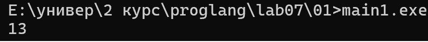

в этой программе одно выражение изменяет ```x``` а другое использует ее текущее значение.
порядок вычислений будет зависеть от стандарта с++
неопределенное поведение возникает только в стандартах до с++ 17


во второй программе операции выполняются последовательно слева направо (x = 33, y = 18)


выполнив третью программу получим:
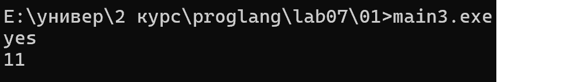

В данном примере используется постфиксный инкремент y++ и логический оператор &&. 
Сначала проверяется условие x > y++, затем, выполняется второе условие y++ > 9. 
В результате выводится yes, а итоговое значение переменной y равно 11


### Задание 2 **(2)**
*Как записать следующие строки программы на С++ в виде одного
выражения? Приведите несколько способов, в том числе с использованием операторов инкремента.*
*Проверьте работу написанных программ*

```
x=x+1;
z=z+2*x+3*y;
y=y+1;
```
*Тексты программ разместите в папке с номером задания*

программы в папке 02

выполнив программы получим:
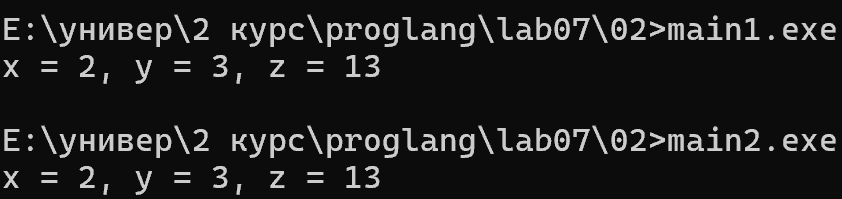

### Задание 3 **(2)**
*Рассмотрите следующий фрагмент программы. Он заполняет вектор из 10 элементов единицами.*
```
std::vector<int> x(10);
for (int i = 0; i < 10;)
   x[i++] = 1;
```
*Перепишите ее так, чтобы в третьей строке использовался префиксный инкремент, но результат ее работы не изменился.*

```
std::vector<int> x(10);
for (int i = -1, i < 9)
   x[++i]=1;
```

### Задание 4 **(2)**

*Почему присваивание* ```(++x)=y``` *является синтаксически правильным, а*
```(x++)=y``` - *нет? Запишите текст сообщения об ошибке, переведите и объясните его.*

для первого написал программу:
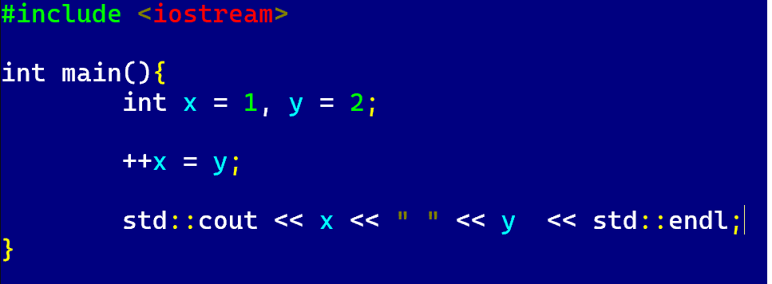

выполнив программу получим:
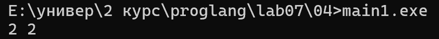

++x сначала увеличивает x на единицу, а затем возвращает саму переменную x как изменяемое значение (ссылку на неё). Поэтому ему можно присвоить новое значение y

для втророго написла программу:
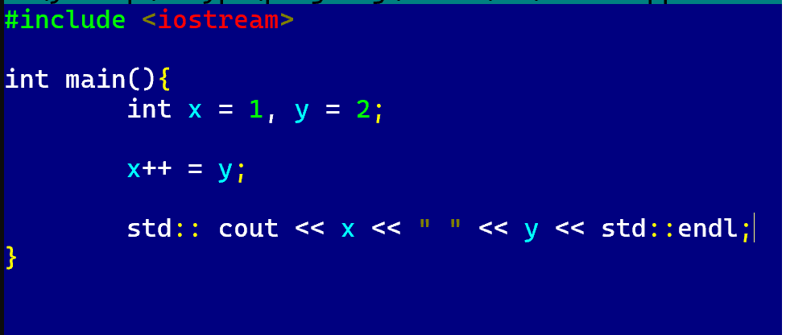

выполнив программу получим:
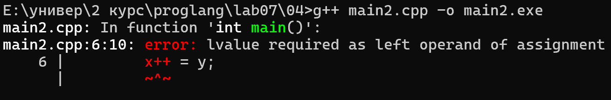

Выражение (x++) = y является некорректным, поскольку постфиксный инкремент возвращает старое значение переменной, которое нельзя использовать для присваивания.

Требуется lvalue в качестве левого операнда присваивания». Это означает, что слева от оператора присваивания должно находиться выражение, которому можно присвоить значение

### Задание 5 **(2)**

*Программисты на Python для обмена значений двух переменных часто пишут строку*
```
a,b = b,a
```
*Проверьте, будет ли аналогичная строка на С++ (с точкой с запятой в конце) являться синтаксически
правильной? Будет ли она обменивать значения переменных? Как в языке С++ вычисляется это выражение?*

написал  программу на с++. выполнив программу получим:
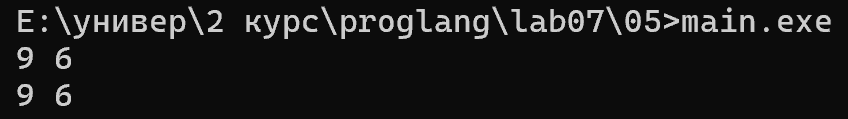

программа скомпилировалась, но переменные не поменялись значениями.
запятая в C++ является оператором, который вычисляет выражения слева направо. Сначала вычисляется a, затем выполняется присваивание b = b, а в конце вычисляется a


### Задание 6 **(2)**

*Проверьте работу следующего фрагмента программы*
```
  std::string s;
  for (int i=0; i<1000000; i++)
     s += 'a';
  std::cout << s.size();
```
*Измените третью строку на*
```
s=s+'a';
```
*Изменится ли что-нибудь в ее работе? Объясните результат.*

программы в папке 06

выполнив программы получим:
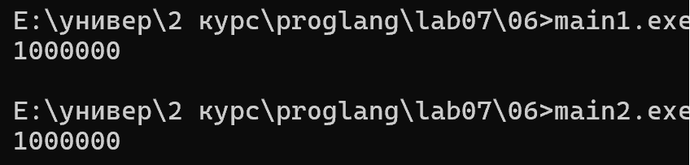

результат один, однако во втором случае программа выполнялась заметно дольше

это происходит так как в первом случае к существующей строке просто добавлется один символ, а во второй программе каждый раз создается новая строка копируя старую и добавляя символ


### Задание 7 **(2)**

*Как работает следующая программа? Как зависит результат от исходного значения?*
```
int x;
std::cin >> x;
x-->0 && x-->0 && x-->0 && x-->0 && x-->0;
std::cout << x;
```

программа в папке 07

выполнив программу с разными исходными значениями получим:
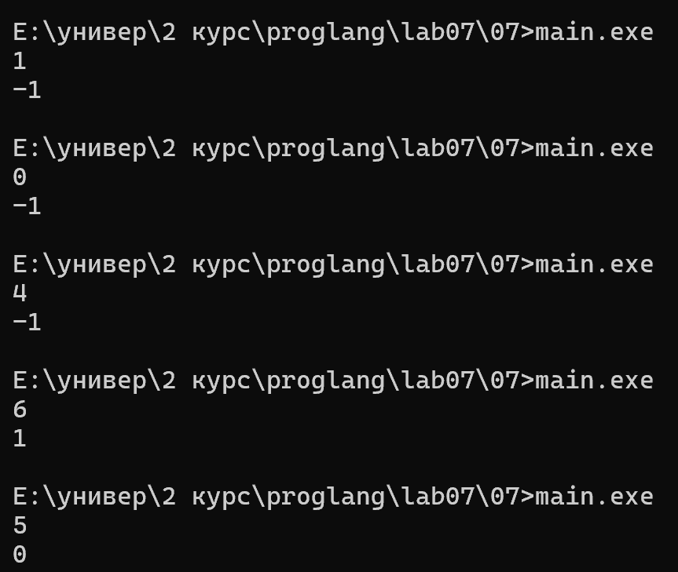
Выражение x-->0 означает x-- > 0: сначала значение x сравнивается с нулём, затем уменьшается на 1. 
Оператор && проверяет условия слева направо и прекращает проверку при первом ложном условии. 
Если исходное значение x меньше или равно 0, результатом будет x - 1. 
Если x от 1 до 4, результат будет -1. 
Если x больше или равно 5, результат будет x - 5


### Задание 8 **(3)**

*Какое число выводит следующий фрагмент программы? Посчитайте результат без использования
вычислительной техники. Отчет должен содержать процесс вычислений.*
```
int s = 0;
for (int i = 0, j = 5; i+j <= 16; (i<j ? i : j)++)
   (s += i) += j;
std::cout << s;
```

выполнив программу получим:
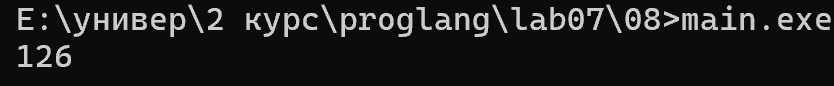

### Задание 8

Начальные значения: `s = 0`, `i = 0`, `j = 5`.

В каждой итерации к `s` прибавляется сумма `i + j`. После выполнения тела цикла увеличивается на 1 меньшее из значений `i` и `j`. Если значения равны, увеличивается `j`.

В начале программы переменные имеют значения s = 0, i = 0, j = 5.

На каждой итерации к переменной s прибавляется сумма i + j. 
Затем увеличивается на единицу меньшее из значений i и j. Если они равны, увеличивается j.

Вычисления:

s = 0 + 0 + 5 = 5
s = 5 + 1 + 5 = 11
s = 11 + 2 + 5 = 18
s = 18 + 3 + 5 = 26
s = 26 + 4 + 5 = 35
s = 35 + 5 + 5 = 45
s = 45 + 5 + 6 = 56
s = 56 + 6 + 6 = 68
s = 68 + 6 + 7 = 81
s = 81 + 7 + 7 = 95
s = 95 + 7 + 8 = 110
s = 110 + 8 + 8 = 126

После этого значения i = 8 и j = 9. Их сумма равна 17, поэтому условие i + j <= 16 не выполняется и цикл завершается

Ответ: 126


###  Задание 9 **(3)**
*Рассмотрите следующую программу. Предполагается, что на вход подается некоторый
индекс в массиве - число от нуля до девяти и значение, которое надо записать по этому индексу.*
```
int i = 0;
std::vector<int> x(10);
std::cin >> i >> x[i];
std::cout << x[i];
```
*Проверьте работу этой программы на различных компиляторах. Найдите два компилятора (можно 
проверить онлайн компиляторы), на которых эта программа будет давать различные ответы при одинаковом
вводе. Как это объяснить?*

Проблема заключается в строке std::cin >> i >> x[i];. В стандарте C++ до C++17 порядок вычисления операндов операторов сдвига не гарантировал, что индекс i будет считан до вычисления x[i]. Поэтому программа могла обращаться к массиву по начальному индексу 0, а не по введённому значению.

Начиная с C++17, левый операнд оператора >> вычисляется раньше правого. Поэтому сначала считывается индекс i, а затем значение записывается в x[i].

Таким образом, различия связаны с изменением правил вычисления выражений в стандарте C++17.
## Дополнительные задания

### Задание 1 **(2)**

*Найдите и объясните примеры "коварных" ошибок программистов на С++, связанных с вычислением выражений. 
Каждый пример оценивается в два балла. Примеры из лекции или из заданий не засчитываются.*

### Задание 2 **(10)**
*Язык С++ позволяет записывать достаточно странные конструкции.
Следующая программа обладает неопределенным поведением. После компиляции с использованием 
Gnu C++ (g++) эта программа выводит числа 4 и 11. Рассмотрите ассемблерный код и объясните,
каким образом был получен ответ 11.*
```
int x, y;
y = (x=1) + (x=2) + (x=3) + (x=4);
std::cout << x << " " << y;
```

### Задание 3 **(10)**
*Прочитайте в стандарте языка С++ правила вычисления результата для тернарного оператора* **?:**. *Напишите примеры для каждого пункта правил.*

