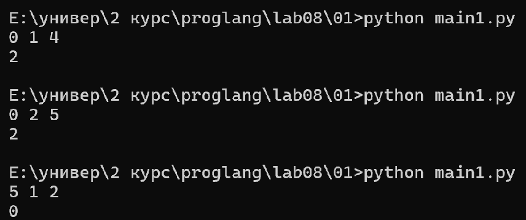
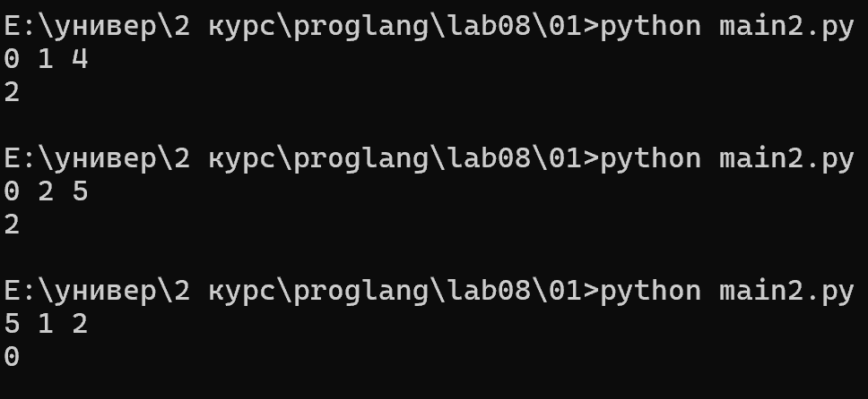
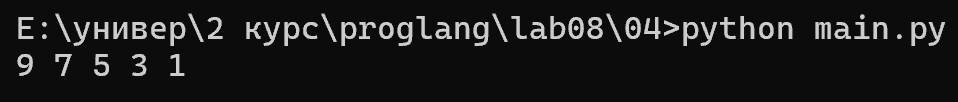
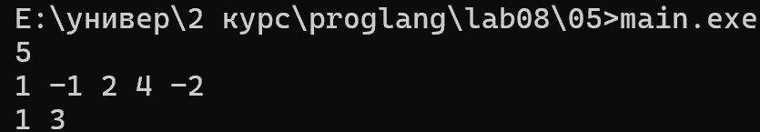
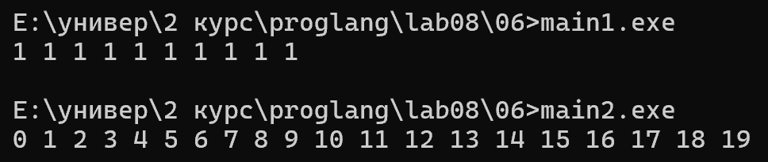
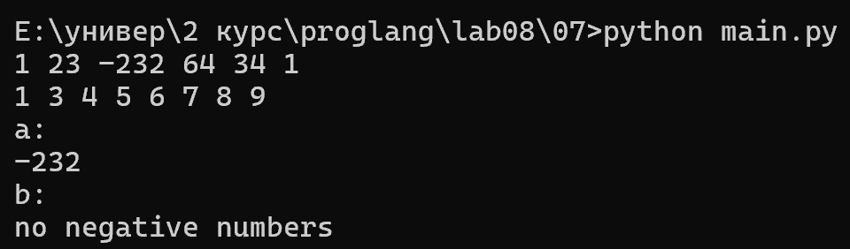
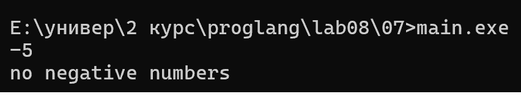
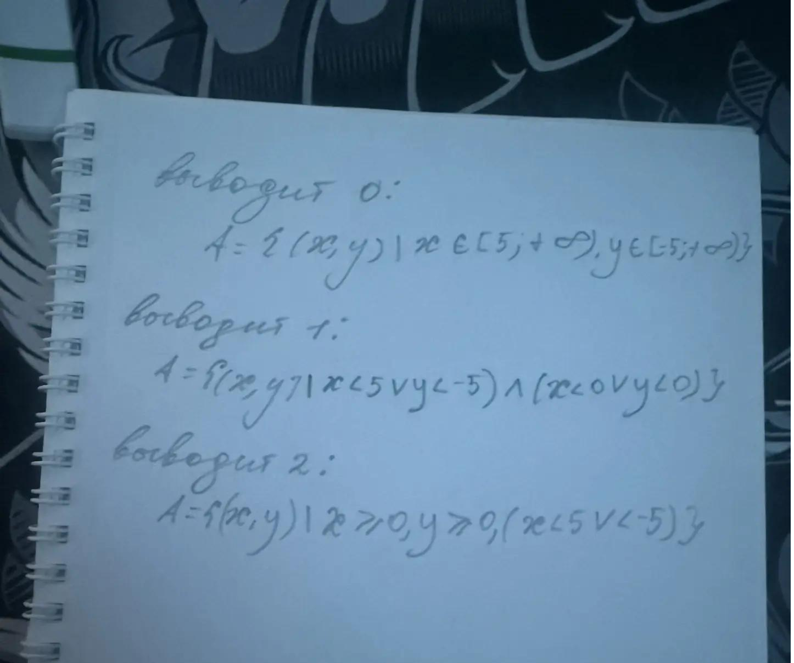
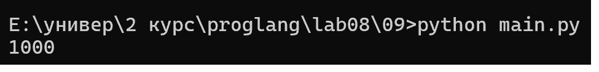

# Языки программирования
## Лабораторная работа 8

### Задание 1 **(2)**
*Рассмотрим программу на языке* **Python**.
```
x = [int(t) for t in input().split()]
for i in range(len(x)):
   if x[i] < i or x[i] > 2*i:
      break
print(i)
```
*Перепишите эту программу так, чтобы в ней использовался цикл* **while**, *в ней не использовалась
инструкция* **break**, *а используемый алгоритм не изменился. Полученная программа должна иметь следующий 
вид.*
```
x = [int(t) for t in input().split()]
i = 0
while ...:
   i += 1
print(i)
```
*Допишите правильное логическое выражение вместо многоточия. Выражение не должно содержать оператор* **not**.

Программы в папке 01

выполнив первую программу на трех разных входных данных получим:


выполнив вторую программу c теми же входными данными получим:


в лекции 8 на слайде 243 сказано что условием выхода из цикла является отрицанием условия продолжения цикла
то есть если не выполняется условие для продолжения цикла то цикл должен закончиться  
в цикл while записал отрицание условия выхода по закону Де Моргана

### Задание 2 **(2)**
*Рассмотрим программу на языке* **Python**.
```
x = [int(t) for t in input().split()]
for i in range(len(x)):
   if i <= x[i] < 2*i or 3*i <= x[i] < 4*i:
      break
print(i)
```
*Перепишите эту программу так, чтобы в ней использовался цикл* **while**, *в ней не использовалась
инструкция* **break**, *а используемый алгоритм не изменился. Полученная программа должна иметь следующий 
вид.*
```
x = [int(t) for t in input().split()]
i = 0
while ...:
   i += 1
print(i)
```
*Допишите правильное логическое выражение вместо многоточия. Выражение не должно содержать оператор* **not**.

программы в папке 02
задание аналогичное первому 


### Задание 3 **(2)**

*Напишите пример программы на* **Java** *с двумя вложенными циклами и инструкцией* **break** *для выхода
из двух вложенных циклов. В качестве такой программы можно взять поиск первого нуля в двумерном массиве.*

для реализации выхода из двух циклов решил использовать логический флаг
когда находим ноль в массиве то флаг становится false и внешний цикл не будет выполняться

программа в папке 03

выполнив программу получим:


также есть вариант использовать метку search  и break search
этот вариант также в папке 03

### Задание 4 **(2)**

*Рассмотрим программу на языке* **Python**.
```
a = list(range(10))
b = [a.pop() - x for x in a]
print(*b)
```
*Объясните, почему список* **b** *получился именно таким.*

выполнив программу получим:


список a создаётся с помощью list(range(10))
Метод pop() удаляет и возвращает последний элемент списка a, а переменная x принимает элементы этого же списка по порядку
список a изменяется и во время его перебора некоторые элементы пропускаются

9 - 0 = 9
8 - 2 = 6
7 - 4 = 3
6 - 6 = 0
5 - 8 = -3

В результате список b содержит значения [9, 6, 3, 0, -3]

### Задание 5 **(2)**

*Напишите программу на С++, которая прочитает натуральное число* **n**, *создаст вектор
из* **n** *элементов, прочитает значения элементов, добавит последний элемент вектора к каждому элементу 
(в том числе и к последнему), найдет и выведет количество положительных и отрицательных элементов вектора
после изменения. Из циклов в программе можно использовать только циклы по коллекции.*

программа в папке 05

выполнив программу получим:


### Задание 6 **(3)**

*Представим, что в некотором будущем стандарте* **С++** *появится конструкция*
```
forc(i, from, to)
```
*которая будет раскрываться в следующий код.*
```
{
   int __i = from, __n=to;
   for(const int &i= __i; i < __n; __i++) {
      ...
   }
}
```
*Чем эта конструкция отличается от стандартного цикла* **for**? *Укажите два основных различия.
Напишите программы для демонстрации этих различий.*

*Написанные программы сохраните в папку с номером задания.*

программы в папке 06

выполнив программы получим:


В первой программе реализуется цикл со счетчиклм, i увеличивается но изменить мы ее не можем, а также верхняя граница вычисляется только один раз
фигурные скобки нужны чтобы создать область видимости

### Задание 7 **(2)**

*Напишите программу на языке* **Python** *для проверки того, что все числа во введенной 
последовательности неотрицательные. Если в цикле будет найдено отрицательное число, цикл должен
прерваться и вывести найденное число. Если отрицательных чисел нет, то вывести некоторое сообщение об этом.*

*Программа должна использовать конструкцию* **for break else**.

*Запишите аналогичную программу на С++. Какие изменения в алгоритме решения в ней появились?. Почему?*

*Написанные программы сохраните в папку с номером задания.*


программы в папке 07
выполнив программу на python получим:


выполнив программу на c++ получим:


так как в с++ нет такой конструкции пришлось использовать переменную флаг

### Задание 8 **(2)**

*Рассмотрим следующую программу.* 
```
if x>=5 and y>=-5:
   print(0):
elif x<0 or y<0:
   print(1):
else:
   print(2):
```
*Опишите множества значений при которых программа выводит 0, 1 и 2. Например,*

A={ (x,y)| x ∈ [5;∞), y ∈ [-5;∞)}



###  Задание 9 **(3)**
*Напишите программу на языке Python для решения следующей задачи.*

*Задана пронумерованная последовательность логических значений* **t(0),t(1),..,t(n)**, **t(i) ∈ {False,True}**

*Последовательность обладает следующим свойством: существует некоторое число k такое, что 
все значения* **t(0),t(1),...,t(k-1)** *равны* **False**, *а все значения* **t(k), ... , t(n)** *равны* **True**,
*то есть слева от* **k** *находятся значения* **False**, *а справа* - **True**. *Последовательность задается
функцией* **t(i)**, *которая возвращает логическое значение. Например, для тестирования эту функцию можно
задать следующим образом.*
```
def t(i):
   return i>=1000
```

*Требуется написать программу, которая найдет число* **k**. *Программа должна реализовывать алгоритм 
бинарного поиска. Диапазон поиска задается переменными* **left** и **right**. *На каждом шаге вычисляется
центр диапазона, значение в нем проверяется, после чего диапазон сокращается в два раза.*

*Алгоритм должен быть записан через цикл* **while** *и реализовывать инвариант цикла*

t(left)=False ∧ t(right)=True

```
left = -1
right = 10**18
while ...:
   mid = ...
   if t(mid):
      ...
   else:
      ...
print(...)
```
программа в папке 09

выполнив программу получим:

## Дополнительные задания

### Задание 1 **(5)**

*Напишите программу на языке С++, которая будет находить сумму элементов в матрице и использовать для суммирования только один цикл* **for**. *(То есть вложенные циклы использовать нельзя).*

### Задание 2 **(15)**
*Напишите программы на языке С++ с использованием разных видов циклов, ветвлений в полной и краткой форме, переведите их в ассемблерный код без оптимизации и опишите, как реализуются эти конструкции в элементарных командах.
правил.*

